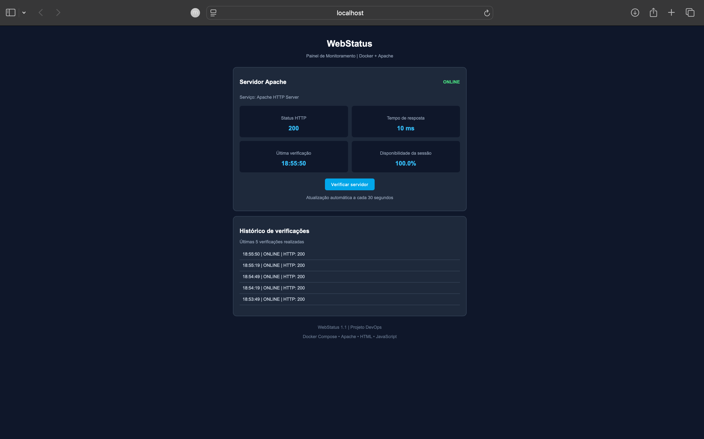

# WebStatus | Monitoramento Web com Docker

Painel de verificação da disponibilidade de um servidor web Apache, desenvolvido como parte do Bootcamp de DevOps da DIO.

O projeto utiliza Docker Compose para executar o Apache em um container e HTML, CSS e JavaScript para apresentar os resultados das verificações HTTP.

## Objetivo

Praticar conceitos de containerização, configuração de serviços, comunicação HTTP e execução de aplicações web usando Docker.

## Tecnologias utilizadas

- Docker Engine
- Docker Compose
- Apache HTTP Server 2.4
- HTML5
- CSS3
- JavaScript
- Ubuntu Server

## Funcionalidades

- Verificação do status HTTP do servidor Apache
- Exibição do tempo de resposta da requisição
- Registro do horário da última verificação
- Cálculo da disponibilidade durante a sessão
- Histórico das cinco últimas verificações
- Verificação manual por botão
- Verificações automáticas a cada 30 segundos enquanto a página está ativa

## Demonstração



## Como executar

É necessário ter Docker Engine e Docker Compose instalados.

Na pasta do projeto, execute:

```bash
sudo docker compose up -d
```

O Docker Compose iniciará o container Apache e disponibilizará a aplicação na porta 8080 do servidor.

Para verificar o container:

```bash
sudo docker compose ps
```

Para testar a resposta HTTP:

```bash
curl -I http://localhost:8080
```

Para acessar a aplicação, abra no navegador:

http://localhost:8080

Observação: em uma máquina virtual, pode ser necessário configurar o acesso à porta 8080, utilizando redirecionamento de portas ou túnel SSH.

Para interromper e remover os containers do projeto:

```bash
sudo docker compose down
```

## Como funciona o monitoramento

Ao abrir a página, o JavaScript realiza uma requisição HTTP ao próprio servidor Apache.

Se o servidor responder com um código HTTP de sucesso, o painel apresenta o status ONLINE.

O sistema também calcula o tempo da requisição, atualiza o horário da verificação e registra o resultado no histórico.

Novas verificações são programadas a cada 30 segundos.

## Limitações

**Este projeto não realiza monitoramento contínuo 24 horas por dia.**

As verificações são executadas pelo JavaScript no navegador e dependem de a página permanecer aberta e ativa.

Ao fechar ou recarregar a página, o histórico e os cálculos da sessão são perdidos.

A disponibilidade apresentada representa apenas o percentual de verificações bem-sucedidas durante a sessão atual, não a disponibilidade real do servidor ao longo de um dia ou mês.

A medição do tempo de resposta é realizada pelo navegador e não equivale a uma medição completa de desempenho do servidor.

O projeto também não monitora CPU, memória, armazenamento ou outros servidores.

## Estrutura do projeto

```text
webstatus/
├── compose.yaml
├── site/
│   └── index.html
├── screenshots/
│   └── webstatus-painel.png
└── README.md
```

## Melhorias futuras

- Monitoramento contínuo independente do navegador
- Coleta de métricas de CPU e memória
- Armazenamento do histórico das verificações
- Dashboards com Grafana
- Coleta de métricas com Prometheus
- Alertas de indisponibilidade

## Aprendizados

Este projeto permitiu praticar a criação de containers, o uso do Docker Compose, o mapeamento de portas, a montagem de volumes e a verificação de serviços HTTP.

Também demonstrou a diferença entre uma aplicação web que realiza verificações durante uma sessão e uma solução de monitoramento contínuo de infraestrutura.

---

Desenvolvido para fins de estudo e prática em DevOps.
